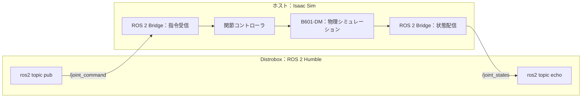

# B601-DM ROS 2 シミュレーションの実装解説

この実装は、**Isaac Sim がロボットの物理シミュレーションと ROS 2 通信を担当し、Distrobox から目標関節角度を送る構成**です。



## 1. ファイルの役割

| ファイル | 役割 |
|---|---|
| [run_sim.sh](../run_sim.sh) | ホスト側の ROS 通信設定を用意し、Isaac Sim の Python で起動 |
| [sim.py](../sim.py) | ロボット配置、ROS 通信の接続、シミュレーション実行 |
| [ros_env.bash](../ros_env.bash) | Distrobox 側の ROS 環境を設定 |
| [fastdds.xml](../fastdds.xml) | DDS の通信方式を UDP に統一 |
| [README.md](../README.md) | 起動・操作手順 |

現段階では、ビルドが必要な ROS パッケージは作っていません。Distrobox 側では標準の `ros2` コマンドを使っています。

## 2. ロボットを配置する処理

[sim.py](../sim.py) の配置処理では、次の順に準備します。

1. ROS 2 Bridge を有効化する。
2. 物理シミュレーション用の `World` を作る。
3. 地面・照明を追加する。
4. 既存の B601-DM の USD を `/World/reBotArm` に読み込む。
5. USD 内から、関節で連結されたロボット全体の起点である **Articulation Root** を探す。
6. カメラ位置を設定する。

モデルは次のファイルを参照しています。

```text
usd/reBot_B601_DM/reBot_B601_DM.usda
```

形状だけでなく、関節・質量・衝突・駆動設定なども既存の USD を利用しています。モデル一式は reBot-Isaacsim（MIT License）の `usd/reBot_B601_DM/` をプロジェクト内にコピーしたもので、実行時に元リポジトリは参照しません。

## 3. ROS 2 と関節制御をつなぐ処理

中心となるのが [sim.py](../sim.py) の Action Graph の作成処理です。

Action Graph は、処理ノードを接続して実行する Isaac Sim の仕組みです。今回は GUI でノードを配置する代わりに、Python で作っています。

| ノード | 役割 |
|---|---|
| `OnPlaybackTick` | シミュレーション中に各処理を実行するきっかけ |
| `ROS2Context` | ROS 通信の共通設定 |
| `ROS2SubscribeJointState` | `/joint_command` を受信 |
| `IsaacArticulationController` | 受信した目標値をロボットへ適用 |
| `IsaacReadJointState` | シミュレーション内の現在の関節状態を取得 |
| `ROS2PublishJointState` | `/joint_states` を配信 |
| `IsaacReadSimulationTime` / `ROS2PublishClock` | シミュレーション時刻を `/clock` に配信 |

例えば、動作確認で実行したコマンドは次の内容を送っています。

```yaml
name: ['joint1']
position: [0.35]
```

受信ノードが「`joint1` の目標位置は `0.35 rad`」と読み取り、関節コントローラへ渡します。**USD に設定された関節の駆動機構が、その目標角度を追従します。**

以前の UDP Receiver は `set_joint_positions()` で関節位置を直接設定していました。今回の実装は、物理シミュレーションの関節コントローラへ指令する方式です。

## 4. /joint_states は実際の計算結果

受信した次の値は、送信した指令のコピーではありません。

```yaml
position: [...]
velocity: [...]
effort: [...]
```

シミュレーション内の関節から取得した、位置・速度・力／トルクの情報です。目標値との小さな差も、そのまま表示されます。

位置の単位は、回転関節がラジアン、グリッパの直動関節がメートルです。以前の Sender にあった角度の符号反転は加えず、USD の関節座標をそのまま使っています。

## 5. ホストと Distrobox が通信できる理由

両側で次を揃えています。

- ROS ディストリビューション：Humble
- `ROS_DOMAIN_ID`：`0`
- 通信実装：Fast DDS
- 通信方式：UDP

ホスト側は Isaac Sim 同梱の ROS ライブラリ、Distrobox 側は `/opt/ros/humble` を使います。Python 環境を共有する必要はなく、ROS メッセージをネットワーク経由で交換します。

`fastdds.xml` は共有メモリ通信を使わない設定です。ホストとコンテナで共有メモリの見え方が異なる問題を避けています。

## 6. 現段階で実装している範囲

シミュレーションは [sim.py](../sim.py) の実行ループで、1ステップあたり `1/60` 秒ずつ進めています。これはシミュレーション時間の刻みで、実時間で常に60 FPSになる保証ではありません。

現在できるのは、**関節の目標値を送ることと、その結果を読み取ること**です。IK、時間指定の軌道実行、MoveIt、`ros2_control` はまだ組み込んでいません。今後、それらの制御処理を Distrobox 側に追加できる土台になっています。
